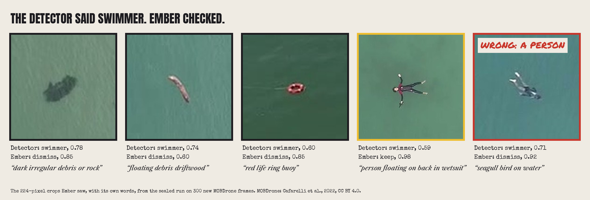
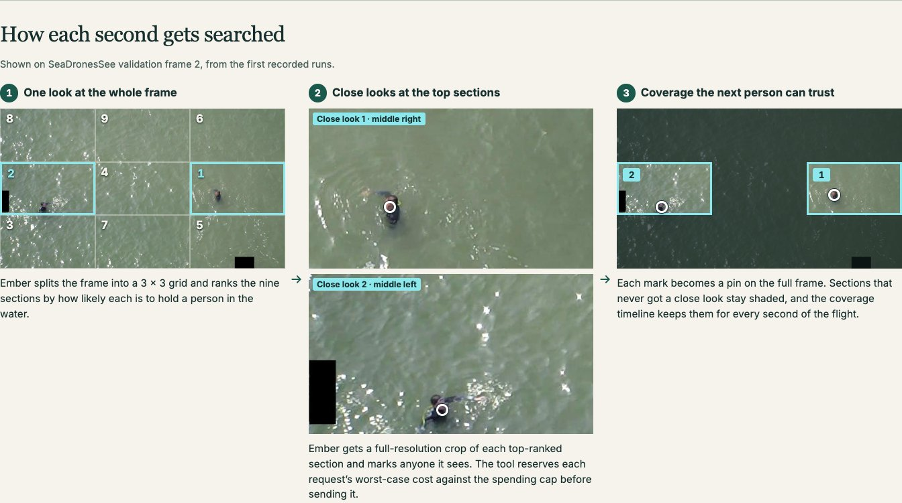

# Open Water Search

**A trained detector flags every second of a drone flight. Muse Ember checks each flag, says what it is, and the crew gets a search record built from what Ember kept.**

On 300 MOBDrone frames the detector had never seen, Ember's check kept the same 210 people and cut false alarms from 166 to 38, **77% fewer, for $0.03**. The pass rule was committed before the run.

~~~
python probe/open_water_search.py flight.mp4 --mode detector-check --detector-python detector-venv/bin/python --out results --budget 0.10
~~~

Built during the Muse Ember Hackathon. The project started on November 23, 2026.

**Try it in your browser:** [How it works](https://open-water-search.vercel.app) · [Take over a search](https://open-water-search.vercel.app/judge) · [Compare Ember with a fixed grid](https://open-water-search.vercel.app/replay). All three pages replay recorded runs, so clicking around costs nothing.

## The result: Ember checks the detector's flags

A free YOLO26m detector trained on SeaDronesSee finds most people in drone footage, but on water it hasn't seen it also flags rocks, driftwood, life rings and birds. In `--mode detector-check`, the detector scans every frame first, keeping every swimmer box at 0.05 confidence or more, at most 12 per frame. Ember then gets one request per flagged frame. Each flag arrives as a 224-pixel crop, and structured output makes Ember answer three questions for every crop: is a person in the water at its centre, how sure is it, and what is there.

~~~mermaid
flowchart LR
    flight["Flight: video or photos, one per second"] --> detector["Trained detector scans every frame whole, flags up to 12 spots"]
    detector --> ember["Muse Ember one request per flagged frame: person? how sure? what is it?"]
    ember -->|keep| record["Search record possible people with Ember's words, a handoff message for each"]
    ember -->|dismiss| reopen["Dismissed flags kept in the report for a person to reopen"]
~~~

**The test** (`runs/verify-mobdrone`). 300 MOBDrone frames, with 297 labeled people, chosen from video names and frame counts alone. Every frame is at least two seconds from any frame used before. The plan and pass rule were committed (82d5225) before any Ember call. The rule compares Ember's check with the detector alone at the highest confidence that still finds as many people.

| 297 labeled people in 300 new MOBDrone frames | Found | False alarms |
|---|---|---|
| Detector alone at 0.30, set to find as many | 210 | 166 |
| **Detector, then Ember** | **210** | **38** |
| Detector alone at 0.62, set to raise about as few false alarms | 125 | 36 |

Ember made 207 requests for $0.0318. A false alarm is any mark with no labeled person under it. Of Ember's 38, 20 are on empty water and 18 are second marks on a person already found.

**Where it did not help.** On 1,517 SeaDronesSee validation photos, the footage the detector was trained on, the same check lost. It found 3,904 people with 291 false alarms, while the detector's own threshold found 3,910 with 104 (`runs/verify-confirm`, $0.2690). So the detector does the first pass, and Ember's check earns its keep on water the detector doesn't know. The 300 MOBDrone frames come from the same 61 videos as an earlier 300-frame test, so this shows the result repeating on new moments of that footage. It does not show it holds on other footage.

**What Ember gets wrong.** Both versions still miss 87 of the 297. Ember dismissed 40 flags that were real people, calling them a dark shape, a bird or an animal. That is why the report lists every dismissed flag with its crop and Ember's words.

**The one command reproduces the sealed run.** Running `--mode detector-check` on the same 300 frames, with the detector run fresh and Ember's sealed answers replayed, sent all 207 requests byte for byte as sealed and scored 210 found with 38 false alarms. `python runs/verify-mobdrone/replay_one_command.py OUT detector-venv/bin/python` repeats it with no network and no key.

## Ember's own search: a flight in, a search record out

Without `--mode detector-check`, Ember searches each frame alone: one overview ranks the nine sections of a 3 × 3 grid, then close looks go to the top-ranked ones. This was the project's first approach. It lost to the trained detector on both tests below, which is why the headline mode lets the detector go first. It needs no detector and no GPU, and it stays the default.

~~~mermaid
flowchart LR
    video["Flight as a video"] -->|"cut into one frame per second"| frames["One frame per second"]
    folder["Flight as a folder of photos, one per second, in time order"] --> frames
    frames --> fixed["Fixed method (default) one overview ranks the 9 sections, close looks at the top 2"]
    frames -.->|"--mode agent"| agent["Agent option Ember picks up to 4 close looks per frame through tool calls"]
    fixed --> sightings["Sightings"]
    agent -.-> sightings
    sightings -->|"back-to-back seconds, within 10% of the frame width"| people["Possible people"]
    people --> record["Search record possible people · coverage timeline · a handoff message for each"]
~~~

On November 24 the command searched a two-minute MOBDrone clip live, one frame per second:

~~~
python3 probe/open_water_search.py clip.mp4 --out runs/live-clip --budget 0.10
~~~

It printed each overview and close look as its answer arrived, then a handoff message for each possible person. Every line, with its time, is in `runs/live-clip/terminal.jsonl`:

~~~
second-00009: close look at the middle right: 1 possible person, confidence 0.95
...
Possible person 1. First seen 0:06, last seen 0:36 into the flight, in the middle left section of second-00036. Confidence 0.98. 7 of the 9 sections of that frame were never searched.
~~~

| The live clip | Result |
|---|---|
| Seconds of footage | 120 |
| Person appearances found | 107 of 116 (92%) |
| Marks with no person | 47 |
| Possible people | 15, for 4 labeled people |
| Cost | $0.0531 |
| Photos per minute | 46.9 (wall time 153.6 s, including cutting the video) |

`probe/check_merge_rule.py` checked how sightings merged into possible people against MOBDrone's track IDs:

- It never joined two different people.
- All 4 labeled people were split into more than one possible person: 6 splits, all within two seconds.
- 7 of the 15 possible people hold no labeled person. MOBDrone labels only people, so some may be boats or buoys, and the rest are false sightings.

The clip carried no drone position, so its handoff messages give the time and the section of the frame. They give no map coordinates.

Every section of every second ends the search in one of four states on the coverage timeline:

~~~mermaid
stateDiagram-v2
    state "Not checked (shaded)" as unchecked
    state "Flagged: Ember marked someone" as flagged
    state "Checked, no sighting" as clear
    state "Unreadable: the answer couldn't be read" as unreadable
    [*] --> unchecked: the overview ranks the section
    unchecked --> flagged: close look with a mark
    unchecked --> clear: close look, nothing marked
    unchecked --> unreadable: close look, unreadable answer
~~~

A section checked with no sighting means Ember looked and reported no one. It does not mean the water is empty.

## The scale run: all 1,547 SeaDronesSee validation photos

Every photo in the SeaDronesSee validation split ran as one flight through the default fixed method on November 24: one overview and two close looks per photo, grounding format, up to 8 requests at once, spending cap $1.47. The trained detector ran on the same photos for comparison (`runs/scale-run`, `detector/`).

| 6,206 swimmers in 1,547 photos | Found | Missed | Marks with no swimmer | Cost | Time |
|---|---|---|---|---|---|
| Ember, fixed method | 3,876 (62%) | 2,330 | 874 | $0.9571 | 44 min |
| Trained detector, whole photo at 640 | 4,283 (69%) | 1,923 | 144 | $0 (local) | about 2 min |
| Trained detector, 3×3 tiles at 640 | 4,213 (68%) | 1,993 | 408 | $0 (local) | about 12 min |

- **Cost:** $0.9571 for 4,641 calls, or about $0.00062 per photo. At one photo a second that is about $2.23 per hour of footage.
- **Speed:** 35.1 photos a minute over the whole run (2,646 s), short of the 60 a minute needed to keep pace with one photo a second. The live clip reached 46.9.
- **Reliability:** every overview was read, with no lost requests and no unreadable answers. The first attempt ended after 57 calls when one request timed out. The fix (one retry, then only that request is lost) is in commit e68172f, and that attempt's $0.0208 is counted in the project's spending.

## Ember alone loses to the trained detector

A YOLO26m detector trained on SeaDronesSee (`detector/`, AGPL-3.0) found more people with fewer false marks than Ember on both tests, under the same scoring rule. On SeaDronesSee its checkpoint was chosen on the same validation split it was scored on, so its numbers there lean optimistic. MOBDrone is footage neither had seen, and the detector won there too:

| 311 labeled people in 300 MOBDrone frames | Found | Missed | Marks with no person | Cost |
|---|---|---|---|---|
| Trained detector, whole photo at 640 | 228 | 83 | 194 | $0 (local) |
| Trained detector, 3×3 tiles at 640 | 217 | 94 | 400 | $0 (local) |
| Ember, fixed method | 205 | 106 | 232 | $0.1364 |

The 300 frames were spread across all 66 MOBDrone videos with a fixed seed and listed before any frame or label was viewed (`mobdrone/frames.json`). A mark counts when it lands inside a labeled box, each box counts once, and each photo keeps at most five marks. The detector's settings were fixed before any label was seen, and `detector/README.md` has both of its runs on every set.

What Ember offers instead:

- **No training data.** Ember was never trained on drone photos and found 205 of the 311 people (66%) on footage new to it. Nothing has to be labeled or trained before a new camera or stretch of water can be searched.
- **A search record and handoff a crew can act on.** A flight comes back as possible people with the seconds they were seen, a coverage timeline of the water nobody searched, and a handoff message for each possible person.
- **A measured, capped cost.** About $0.00062 per photo, or about $2.23 per hour of footage at one photo a second, with the default grounding format. The detector runs free on a local GPU. The tool stops before any request could cross its spending cap.

## Two checks on the 30 validation photos

**Meta's grounding format became the default** (`runs/format-check`). Close looks asked for points on Meta's 0–1,000 grid, with structured output forcing a JSON schema. The pass rule was fixed in advance:

| 134 swimmers | Pass rule | Result |
|---|---|---|
| Found with one close look | at least 63 | 69 |
| Found with two close looks | at least 74 | 79 |
| Marks with no swimmer, two close looks | at most 24 | 13 |

**Letting Ember choose its own close looks lost** (`runs/agent-check`). With `--mode agent`, Ember saw each overview and chose its close looks through three tools: look closer at a tile, report a sighting, and move to the next frame. It had to beat the fixed method at the same total spend:

| 134 swimmers, equal spend | Found | Marks with no swimmer | Calls |
|---|---|---|---|
| Fixed method, grounding format | 79 | 13 | 90 |
| Agent mode | 54 | 11 | 51 |

Each tool-calling step resends the frame's conversation and the tool definitions, so the same money bought 51 calls instead of 90, and 9 of the 30 photos never got a close look. The fixed method stays the default, and agent mode stays available.

## How each second is searched

1. **Overview.** Each frame gets one Ember call that ranks the nine sections of a 3 × 3 grid by how likely each is to hold a person in the water.
2. **Close looks.** Each frame then gets a close look at its top-ranked section, then its second, one round at a time, until the per-frame count (`--looks`, default 2) or the spending cap runs out. Before every request, the tool reserves the request's worst-case cost within `--budget`, so requests running at once can never cross it together.
3. **Search record.** Sightings in back-to-back seconds within 10% of the frame width merge into one possible person, and a gap of more than 2 seconds starts a new one. Code writes a handoff message for each possible person from the search record, and the coverage timeline keeps every section that never got a close look.

## Supporting detail: where the first close look goes

Before the scale run, we compared three ways to spend close looks on the same 30 photos, using the same recorded Ember answer for every crop, so only the order in which tiles are opened differs. These runs used the original frozen prompts.

- **Ember picks the tile** from its one overview.
- **Always zoom the center** first, then continue in grid order.
- **Fixed grid order.**

~~~mermaid
xychart-beta
    title "One close look per photo: swimmers found of 134"
    x-axis ["Ember picks the tile", "Always zoom the center", "Fixed grid order"]
    y-axis "Swimmers found" 0 --> 134
    bar [63, 30, 7]
~~~

**Validation: 30 untouched SeaDronesSee validation frames, 134 swimmers.** The measure and the pass rule were written down before any call. Each cell counts labeled swimmers found under a limit of five sightings per frame. Ranges cover the two answer sets, one from each search's pass over the frames.

| Close looks per frame | 1 | 2 | 3 | All 9 |
|---|---|---|---|---|
| Ember picks the tile from one overview | 63–64 | 74 | 75–77 | 77–78 |
| Always zoom the center first | 30–31 | 31–33 | 34–37 | 76–78 |
| Fixed grid order | 7 | 16 | 24–25 | 77–78 |

With all nine tiles opened, every order finds the same swimmers. The gain comes from where the first looks go.

**First run: 30 SeaDronesSee training frames, 158 swimmers.** This comparison was defined after the labels were opened, which is why we repeated it on validation.

| Close looks per frame | 1 | 2 | 3 | All 9 |
|---|---|---|---|---|
| Ember picks the tile from one overview | 65–73 | 83–92 | 86–95 | 85–94 |
| Always zoom the center first | 28–38 | 30–41 | 42–53 | 85–94 |
| Fixed grid order | 7–10 | 18–24 | 36–44 | 85–94 |

From one overview, Ember's first-ranked tile held a labeled swimmer in 26 of 30 first-run frames and 24 of 30 validation frames. With the frozen prompts, an overview plus two close looks cost about $0.00052 per photo, or $1.88 per 3,600 photos. The current grounding-format default measured about $0.00062 per photo on the scale run, about $2.23 per hour of footage.

## What this does not show

- **Detector, then Ember on other footage.** The passing test used new frames from the same MOBDrone videos as an earlier test. On SeaDronesSee, the detector's own footage, Ember's check lost to the detector's threshold.
- **Keeping pace with a drone.** The search reached 35.1 photos a minute on the scale run and 46.9 on the live clip, short of one photo a second.
- **Equal spend with each search's own answers.** In the frozen-prompt runs we planned this head-to-head too, and it does not support a claim either way. In the first run, both searches eventually sent identical crops, and Ember returned a different number of marks on 12 of those 270 crops between passes. That variation is as large as the gap between the searches. In validation, the totals were 78 against 77 with our reader and 75 against 65 with a stricter one. Both scorecards are published.
- **Reviewer speed.** There is no claim that a reviewer finds people faster. That needs a timed test on fresh footage.

## Why the unchecked water matters

On July 4, 2021, a Glendale, Wisconsin police drone found two paddleboarders on Lake Michigan and held a light on them while boats came in. The crew could reach the boats only through dispatch. Later, the officer told us: "Honestly, we didn't know if the boats knew." Finding someone is half the job. The other half is making sure the next person knows exactly where to look, and which water nobody has checked.

## Run it on your own flight

~~~
pip install pillow
export MODEL_API_KEY=your-meta-model-api-key
python probe/open_water_search.py flight.mp4 --out results --budget 0.10
open results/report.html
~~~

Point it at a flight: a video file, which the tool cuts into one frame per second with ffmpeg, or a folder of .jpg, .jpeg or .png photos whose file names put them in time order, one photo per second. Sightings at most two seconds apart and within 10% of the frame width of each other become one possible person, and the tool prints a handoff message for each. Use `--looks` to change the close looks per frame, `--parallel` to change how many requests run at once (default 8), `--format frozen` for the original prompts, and `--key-file` instead of the environment variable if you prefer. The tool spaces requests out when Meta's rate-limit headers run low, and after a 429 it waits at least the Retry-After time, then backs off with jitter. If the spending cap is reached, the tool stops and says so in the search record and the report. A request that times out, drops its connection or gets a 5xx reply is retried once. If it fails again, only its own overview or tile is lost, and the run continues. Ten unreadable answers in a row, or any other failure, end the run: the tool writes the search record and the report for everything finished so far, then exits with status 1.

If the flight has the drone's GPS position for its photos, pass it with `--positions positions.json`: a JSON file whose `frames` object maps each photo's name (without extension, or `second-00000`, `second-00001` and so on for a video) to `{"latitude": ..., "longitude": ...}` in decimal degrees, or to `null` when that photo has none. Each handoff message then gives the drone position at sighting, and the report maps where the drone was. The tool doesn't compute the person's own coordinates, because the flight data has no camera field of view and measures altitude from the takeoff point. Photos without position data get no coordinates. Without the file, the search record says position data was unavailable and the report shows no map. `probe/write_positions.py` writes this file for SeaDronesSee frames from the dataset's CC0 `instances_val.json`, and `validation/inputs/positions.json` is its output for the 30 validation photos, 22 of which have a position.

Add `--mode detector-check` to have the trained detector flag every frame first and Ember check each flag. It needs a Python with ultralytics for the detector, passed as `--detector-python`, and the detector runs as its own program, so the MIT search tool imports nothing from the AGPL-3.0 `detector/` folder:

~~~
python -m venv detector-venv
detector-venv/bin/pip install ultralytics==8.4.218
python probe/open_water_search.py flight.mp4 --mode detector-check --detector-python detector-venv/bin/python --out results --budget 0.10
~~~

The detector downloads its pinned weights on first use and runs on the Apple GPU by default. Pass `--detector-device cpu`, or a CUDA device number, elsewhere. It keeps swimmer boxes at 0.05 confidence or more, at most 12 per frame, and Ember gets one request per frame that has any. The tool prints Ember's verdict on each flag in its own words as the answers arrive. Kept flags become sightings, and they merge into possible people the same way. Each handoff message quotes what Ember said and how many of that frame's flags it kept and dismissed. The report lists every dismissed flag with its crop, so a reviewer can reopen it, and `detector-boxes.json` holds every box the detector returned. The detector runs before any Ember call, so a missing ultralytics stops the run before it spends anything. On the 300 MOBDrone frames, the check cost about $0.0001 per frame.

Add `--mode agent` to let Ember run the search through tool calls. Each frame gets one conversation that opens with its overview and a one-line note about the previous frame's sightings. Ember chooses which tiles to look at closely, at most 4 per frame, reports each sighting as a point on Meta's 0–1,000 grid over the close look it received, and moves to the next frame when it decides to. Each frame earns an equal share of `--budget`, and any share it leaves unused carries forward. The tool prints a line for each tool call as it happens. It lost to the fixed method on the 30 validation photos, so the fixed method stays the default.

| File in `results/` | What it holds |
|---|---|
| `search-record.json` | The search record: every possible sighting in source-image pixels, the possible people they merge into with a handoff message for each, the coverage timeline with every section's status for every second, every Ember call with its tokens and cost, and how the run ended |
| `report.html` | The reviewer queue, highest confidence first, and a coverage map of every frame, built from the search record |
| `queue.json` | Up to five sightings per frame, in source-image pixels, built from the search record |
| `coverage.json` | Every section's status for every frame, from the search record |
| `calls.jsonl` | Every Ember request, with its token usage, cost and answer |
| `detector-boxes.json` | In `--mode detector-check`, every box the detector returned for every frame |

With the default grounding format, an overview plus two close looks cost about $0.00062 per photo on the scale run, or about $2.23 per hour of footage at one photo a second. The search record also records photos per minute.

## The three web pages

| Page | What you do there |
|---|---|
| [How it works](https://open-water-search.vercel.app) (`pages/index.html`) | Watch the live two-minute run print Ember's decisions and fill in its coverage timeline, read the handoff message for each possible person, then see the scale run, the detector comparison and the steps on one real validation photo |
| [Take over a search](https://open-water-search.vercel.app/judge) (`pages/judge.html`) | Ember has taken one overview, opened its top tile and flagged a possible swimmer. You mark it, dismiss it or say you can't tell. Then you pick the next tile, see Ember's recorded close look there, and reveal the labels. |
| [Replay](https://open-water-search.vercel.app/replay) (`pages/replay.html`) | Put Ember and the fixed grid side by side on every frame of either run, at 1 to 9 close looks per frame, with spend and totals across all 30 frames |

The take-over page works like this:

~~~mermaid
stateDiagram-v2
    state "Ember flagged a tile" as flag
    state "Look at Ember's close look" as crop
    state "Pin the swimmer on the full photo" as pin
    state "Pick the next tile" as pick
    state "See Ember's look at your tile" as next
    state "What was there" as reveal
    [*] --> flag
    flag --> crop: Open Ember's close look
    crop --> pin: Mark a swimmer
    crop --> pick: Dismiss the flag / Can't tell
    pin --> crop: Back (keeps your pin)
    pin --> pick: Lock my pin
    pick --> next: Open this tile
    next --> reveal: Reveal the labels
    reveal --> flag: Try another search / Start this one over
~~~

The reveal shows whether the flag was real, where your pin landed, what your pick held, what Ember would have opened next, and how many swimmers remain in water nobody has checked. Cases follow manifest order and include every validation frame whose first close look flagged something and which has a swimmer outside that tile. The replay page's totals at nine looks match `score.json`, and at one to three looks they match the order table.

To run the pages locally:

~~~
pip install pillow
python probe/fetch_frames.py
python -m http.server 8000
~~~

Then open `http://localhost:8000/pages/index.html`. `probe/build_pages.py` rebuilds `pages/runs/` from the sealed traces and from `runs/live-clip`, and reads no labels. The pages load labels in the browser from the files `fetch_frames.py` downloads.

The hosted site comes from `python probe/build_site.py`, which copies the pages, the run data, and the frames resized to 2,400 pixels, along with their labels, into `site/`. Then `vercel deploy site --prod` publishes it. SeaDronesSee is CC0, so the site can carry frames and labels that this repository leaves out.

## Muse Ember usage

The November 23 runs used the frozen prompts. Their token usage, from the answers Meta returned:

| | Calls | Input tokens | Cached input | Output tokens | Reasoning tokens | Cost |
|---|---|---|---|---|---|---|
| First run | 570 | 396,696 | 61,786 | 64,829 | 52,879 | $0.0662 |
| False start | 46 | 33,333 | 0 | 8,345 | 7,718 | $0.0075 |
| Validation | 570 | 373,864 | 61,606 | 70,966 | 59,924 | $0.0670 |
| Tool test | 12 | 7,632 | 0 | 3,116 | 2,712 | $0.0023 |
| **Total, November 23** | **1,198** | **811,525** | **123,392** | **147,256** | **123,233** | **$0.1429** |

Costs use Meta's published Muse Ember rates: $0.10 per million input tokens, $0.004 per million cached input tokens and $0.50 per million output tokens, below 200,000 tokens of context. Each call's prompt hash, image hash, timing, usage and raw answer are in the traces.

The November 24 runs, with the cost each run folder's README reports. Every call's token usage and cost are in that folder's `calls-redacted.jsonl`.

| Run | Cost |
|---|---|
| Format check, 90 calls (`runs/format-check`) | $0.0192 |
| Agent check, 51 calls (`runs/agent-check`) | $0.0178 |
| Scale run, first attempt, stopped by a timeout after 57 calls | $0.0208 |
| Scale run, 4,641 calls (`runs/scale-run`) | $0.9571 |
| MOBDrone, 300 frames (`runs/mobdrone-300`) | $0.1364 |
| Live two-minute clip (`runs/live-clip`) | $0.0531 |
| Detector, then Ember: 300 MOBDrone frames and 30 validation photos (`runs/verify-check`) | $0.0391 |
| Detector, then Ember: confirmation on 1,517 validation photos, failed (`runs/verify-confirm`) | $0.2690 |
| Detector, then Ember: 300 new MOBDrone frames, passed (`runs/verify-mobdrone`) | $0.0318 |

## Reproduce the numbers

~~~
pip install pillow
python probe/fetch_frames.py      # downloads the 60 frames and labels from the pinned mirror and checks every hash
python probe/check.py             # offline checks with simulated answers, no API calls
python -m unittest discover -s probe  # the command end to end against a simulated Ember, no API calls
python probe/score.py             # rebuilds the first-run scorecards and compares them with live/
python probe/score.py validation  # the same for validation/live/
~~~

The order tables are under `order_table` in each `score.json`. `score.py` refuses to score unless the trace matches its seal.

`python probe/score.py record SEARCH_RECORD SCORING_DIR` prints the scorecard for a search record under the same rule, and `python probe/score.py detector BOXES_JSON SCORING_DIR` does the same for the detector's boxes. Each folder under `runs/` keeps its published scorecard and the seal of its search record and calls log. `detector/README.md` has the detector's commands.

To make your own sealed run on macOS, move `live/` or `validation/live/` aside. Then, with `MODEL_API_KEY` set, run `sh probe/isolate.sh runner.py --dataset probe --prior-nanodollars 0` from the repository root. The launcher uses `sandbox-exec` so the inference process cannot read the label folders. The runner caps a run at $0.49, reserves each request's worst-case cost before sending it, and stops after ten unreadable answers in a row. After a 429 rate-limit reply, it waits once and retries once, as Meta's rate-limit guidance asks.

## Run record

- **Settings.** Model `muse-ember-1.0` on the Meta Model API, minimal reasoning, a 2,000-token output limit, 3 x 3 tiles resized to at most 1,000 pixels on the long edge, and JPEG quality 90. The prompts are in `probe/runner.py`, and their hashes are in each `settings.json`.
- **False start.** The first attempt used a 384-token output limit. Ember spent it on reasoning and returned empty answers for 14 of 16 overviews, which tripped the failure breaker after 46 calls ($0.0075). Earlier in that attempt, the reader was amended to accept a bare `[]` as an empty answer. The attempt is preserved, with response IDs removed, in `false-start/`. It was restarted from scratch with the 2,000-token limit, and its cost counted toward the $0.49 cap.
- **0–1,000 coordinates.** Some close looks returned points on Meta's 0–1,000 image grid instead of the fractions the prompt asked for. Before any label was opened, we fixed a rule that converts them. `score.json` applies it, and `score-strict.json` discards those answers.
- **Frames.** The first run's 30 frames were drawn by a seeded hash from a 400-image local training pool, listed in `inputs/training-pool.txt`. Validation drew 30 frames from the 1,547-image validation split, skipping any within 8 bits of a pool image on a 64-bit difference hash (`probe/select_validation.py`). Fifteen of the first 45 candidates were skipped, which suggests the splits share source videos. Nothing was tuned on any frame.
- **Spend.** $0.0662 for the first run plus $0.0075 for the false start, $0.0670 for validation, and $0.0023 for the four-frame tool test in `examples/tool-test/`.

## What is and isn't here

The traces are Ember's replies as returned, minus Meta's response and message IDs. `redaction.json` gives the SHA-256 of each original trace, which matches its `seal.json`, and of the redacted copy. No API key is stored anywhere in the repository. The SeaDronesSee images and labels are not included. `fetch_frames.py` downloads them from the mirror at revision `deb1f872` and checks each one against the SHA-256 recorded in the manifests. `docs/` holds a screenshot of the landing page, the search steps on one validation frame, and the five MOBDrone crops of the detector-check result.

The MOBDrone videos, frames and labels are not included either, apart from the five 224-pixel crops in `docs/ember-check-examples.png`, credited to MOBDrone's authors under CC BY 4.0. `mobdrone/frames.json` lists the 300 frames of unseen footage, by video, frame number and time, with the SHA-256 of each of the 66 source videos. `select_mobdrone.py` chose them from video names and frame counts alone, with a fixed seed, and the list was committed before any frame or label was viewed. `python probe/fetch_mobdrone.py DATA_DIR` downloads the videos and the people-only labels from Zenodo, checks them against Zenodo's MD5 and the recorded SHA-256, unpacks the videos into `DATA_DIR/videos`, and checks that the label file has an entry for every frame of every video, the 300 chosen ones included.

`python probe/extract_mobdrone.py DATA_DIR SAMPLE_DIR` then takes each of the 300 frames by its frame number and saves it in `SAMPLE_DIR/images` under a name that keeps the list's order, so the folder searches as a flight. It converts the frame's person boxes into a YOLO label file with class 0, the class scored as a swimmer, and writes `mobdrone/inputs/manifest.json` and `mobdrone/scoring-only/manifest.json` with the SHA-256 of every photo and label. `probe/cut_mobdrone_clip.py` cuts the two-minute clip for the live run and labels each second the search tool will cut from it, with MOBDrone's track IDs. `probe/check_merge_rule.py SEARCH_RECORD SCORING_DIR` counts how often the possible-person merge rule joined two different labeled people and how often it split one.

## Credits and license

Frames and labels come from SeaDronesSee (Varga, Kiefer, Messmer and Zell, University of Tübingen; [arXiv:2105.01922](https://arxiv.org/abs/2105.01922)), released under CC0 and read here through the [dronefreak/SeaDronesSee](https://huggingface.co/datasets/dronefreak/SeaDronesSee) mirror. The code is MIT licensed.

The unseen footage comes from MOBDrone (Cafarelli, Ciampi, Vadicamo, Gennaro, Berton, Paterni, Benvenuti, Passera and Falchi; [arXiv:2203.07973](https://arxiv.org/abs/2203.07973)), released under [CC BY 4.0](https://creativecommons.org/licenses/by/4.0/) on [Zenodo](https://doi.org/10.5281/zenodo.5996890). This repository lists frame numbers and hashes only and does not modify the dataset.
