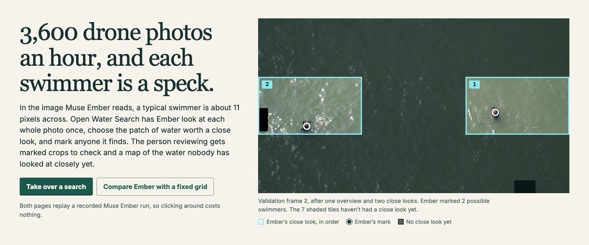

# Open Water Search

A drone shooting one photo a second makes 3,600 photos an hour. In the image Muse Ember reads, a typical swimmer in them is about 11 pixels across. Open Water Search has Ember look at each whole photo once, choose the patch of water worth a close look, and mark anyone it finds. The person reviewing gets marked crops to check and a map of the water nobody has looked at closely yet.

Built during the Muse Ember Hackathon, November 23 to December 2, 2026.

**Try it in your browser:** [How it works](https://open-water-search.vercel.app) · [Take over a search](https://open-water-search.vercel.app/judge) · [Compare Ember with a fixed grid](https://open-water-search.vercel.app/replay). All three pages replay a recorded run, so clicking around costs nothing.

## How it works

~~~mermaid
flowchart LR
    photos["Folder of drone photos"] --> overview["1. Overview Ember sees each whole photo and ranks its 9 tiles"]
    overview --> look["2. Close look Ember gets the next-ranked tile at full resolution and marks anyone it sees"]
    look --> more{"More close looks per photo, and budget left?"}
    more -- yes --> look
    more -- no --> report["3. Handoff report.html: reviewer queue and coverage map"]
~~~

1. **Overview.** Every photo gets one Ember call that ranks the nine tiles of a 3 × 3 grid by how likely each is to hold a person in the water.
2. **Close looks.** Each photo then gets a close look at its top-ranked tile, then its second, one round at a time, until the per-photo count (`--looks`, default 2) or the budget runs out. Before every request, the tool checks that the request's worst-case cost fits within `--budget`.
3. **Handoff.** The reviewer gets every mark as a crop and as a pin on the full photo, highest confidence first, and a coverage map showing which water got a close look.

Every tile on the coverage map ends up in one of four states:

~~~mermaid
stateDiagram-v2
    state "Not checked (shaded)" as unchecked
    state "Flagged (yellow): Ember marked someone" as flagged
    state "Checked, no sighting (blue)" as clear
    state "Unreadable (dashed orange)" as unreadable
    [*] --> unchecked: overview ranks the tile
    unchecked --> flagged: close look with a mark
    unchecked --> clear: close look, nothing marked
    unchecked --> unreadable: close look, answer couldn't be read
~~~

A blue tile means Ember looked and reported no one. It does not mean the water is empty, and the reviewer can still open it.

## Run it on your own photos

~~~
pip install pillow
export MODEL_API_KEY=your-meta-model-api-key
python probe/open_water_search.py path/to/photos --out results --budget 0.05
open results/report.html
~~~

Point it at a flight: a folder of .jpg, .jpeg or .png photos whose file names put them in time order, one photo per second. Sightings at most two seconds apart and within 10% of the frame width of each other become one possible person, and the tool prints a handoff message for each. Use `--looks` to change the close looks per photo, and `--key-file` instead of the environment variable if you prefer. If the budget runs out, the tool stops and says so in the search record and the report. If a request fails, it also writes them for everything finished so far, then exits with status 1.

If the flight has the drone's GPS position for its photos, pass it with `--positions positions.json`: a JSON file whose `frames` object maps each photo's name (without extension) to `{"latitude": ..., "longitude": ...}` in decimal degrees, or to `null` when that photo has none. Each handoff message then gives the drone position at sighting, and the report maps where the drone was. The tool doesn't compute the person's own coordinates, because the flight data has no camera field of view and measures altitude from the takeoff point. Photos without position data get no coordinates. Without the file, the search record says position data was unavailable and the report shows no map. `probe/write_positions.py` writes this file for SeaDronesSee frames from the dataset's CC0 `instances_val.json`, and `validation/inputs/positions.json` is its output for the 30 validation photos, 22 of which have a position.

| File in `results/` | What it holds |
|---|---|
| `search-record.json` | The search record: every possible sighting in source-image pixels, the possible people they merge into with a handoff message for each, every tile's status for every photo, every Ember call with its tokens and cost, and how the run ended |
| `report.html` | The reviewer queue, highest confidence first, and a coverage map of every photo, built from the search record |
| `queue.json` | Up to five sightings per photo, in source-image pixels, built from the search record |
| `coverage.json` | Every tile's status for every photo, from the search record |
| `calls.jsonl` | Every Ember request, with its token usage, cost and answer |

An overview plus two close looks cost about $0.00052 per photo in our runs, or $1.88 per 3,600 photos. Requests go one at a time, about 4.4 seconds per photo.

## What we measured

We compared three ways to spend close looks on the same photos, using the same recorded Ember answer for every crop, so only the order in which tiles are opened differs:

- **Ember picks the tile** from its one overview.
- **Always zoom the center** first, then continue in grid order.
- **Fixed grid order.**

~~~mermaid
xychart-beta
    title "One close look per photo: swimmers found of 134"
    x-axis ["Ember picks the tile", "Always zoom the center", "Fixed grid order"]
    y-axis "Swimmers found" 0 --> 134
    bar [63, 30, 7]
~~~

**Validation: 30 untouched SeaDronesSee validation frames, 134 swimmers.** The measure and the pass rule were written down before any call. Each cell counts labeled swimmers found under a limit of five sightings per frame. Ranges cover the two answer sets, one from each search's pass over the frames.

| Close looks per frame | 1 | 2 | 3 | All 9 |
|---|---|---|---|---|
| Ember picks the tile from one overview | 63–64 | 74 | 75–77 | 77–78 |
| Always zoom the center first | 30–31 | 31–33 | 34–37 | 76–78 |
| Fixed grid order | 7 | 16 | 24–25 | 77–78 |

With all nine tiles opened, every order finds the same swimmers. The gain comes from where the first looks go.

**First run: 30 SeaDronesSee training frames, 158 swimmers.** This comparison was defined after the labels were opened, which is why we repeated it on validation.

| Close looks per frame | 1 | 2 | 3 | All 9 |
|---|---|---|---|---|
| Ember picks the tile from one overview | 65–73 | 83–92 | 86–95 | 85–94 |
| Always zoom the center first | 28–38 | 30–41 | 42–53 | 85–94 |
| Fixed grid order | 7–10 | 18–24 | 36–44 | 85–94 |

From one overview, Ember's first-ranked tile held a labeled swimmer in 26 of 30 first-run frames and 24 of 30 validation frames.

### What this does not show

- **Equal spend with each search's own answers.** We planned this head-to-head too, and it does not support a claim either way. In the first run, both searches eventually sent identical crops, and Ember returned a different number of marks on 12 of those 270 crops between passes. That variation is as large as the gap between the searches. In validation, the totals were 78 against 77 with our reader and 75 against 65 with a stricter one. Both scorecards are published.
- **Speed.** There is no claim that a reviewer finds people faster. That needs a timed test on fresh footage.

## Why the unchecked water matters

On July 4, 2021, a Glendale, Wisconsin police drone found two paddleboarders on Lake Michigan and held a light on them while boats came in. The crew could reach the boats only through dispatch. Later, the officer told us: "Honestly, we didn't know if the boats knew." Finding someone is half the job. The other half is making sure the next person knows exactly where to look, and which water nobody has checked.

## The three web pages

| Page | What you do there |
|---|---|
| [How it works](https://open-water-search.vercel.app) (`pages/index.html`) | See the three steps and the results on one real validation photo |
| [Take over a search](https://open-water-search.vercel.app/judge) (`pages/judge.html`) | Ember has taken one overview, opened its top tile and flagged a possible swimmer. You mark it, dismiss it or say you can't tell. Then you pick the next tile, see Ember's recorded close look there, and reveal the labels. |
| [Replay](https://open-water-search.vercel.app/replay) (`pages/replay.html`) | Put Ember and the fixed grid side by side on every frame of either run, at 1 to 9 close looks per frame, with spend and totals across all 30 frames |

The take-over page works like this:

~~~mermaid
stateDiagram-v2
    state "Ember flagged a tile" as flag
    state "Look at Ember's close look" as crop
    state "Pin the swimmer on the full photo" as pin
    state "Pick the next tile" as pick
    state "See Ember's look at your tile" as next
    state "What was there" as reveal
    [*] --> flag
    flag --> crop: Open Ember's close look
    crop --> pin: Mark a swimmer
    crop --> pick: Dismiss the flag / Can't tell
    pin --> crop: Back (keeps your pin)
    pin --> pick: Lock my pin
    pick --> next: Open this tile
    next --> reveal: Reveal the labels
    reveal --> flag: Try another search / Start this one over
~~~

The reveal shows whether the flag was real, where your pin landed, what your pick held, what Ember would have opened next, and how many swimmers remain in water nobody has checked. Cases follow manifest order and include every validation frame whose first close look flagged something and which has a swimmer outside that tile. The replay page's totals at nine looks match `score.json`, and at one to three looks they match the order table.

To run the pages locally:

~~~
pip install pillow
python probe/fetch_frames.py
python -m http.server 8000
~~~

Then open `http://localhost:8000/pages/index.html`. `probe/build_pages.py` rebuilds `pages/runs/` from the sealed traces and reads no labels. The pages load labels in the browser from the files `fetch_frames.py` downloads.

The hosted site comes from `python probe/build_site.py`, which copies the pages, the run data, and the frames resized to 2,400 pixels, along with their labels, into `site/`. Then `vercel deploy site --prod` publishes it. SeaDronesSee is CC0, so the site can carry frames and labels that this repository leaves out.

## Muse Ember usage

Every call made for this project, from the token usage Meta returned with each answer:

| | Calls | Input tokens | Cached input | Output tokens | Reasoning tokens | Cost |
|---|---|---|---|---|---|---|
| First run | 570 | 396,696 | 61,786 | 64,829 | 52,879 | $0.0662 |
| False start | 46 | 33,333 | 0 | 8,345 | 7,718 | $0.0075 |
| Validation | 570 | 373,864 | 61,606 | 70,966 | 59,924 | $0.0670 |
| Tool test | 12 | 7,632 | 0 | 3,116 | 2,712 | $0.0023 |
| **Total** | **1,198** | **811,525** | **123,392** | **147,256** | **123,233** | **$0.1429** |

Costs use Meta's published Muse Ember rates: $0.10 per million input tokens, $0.004 per million cached input tokens and $0.50 per million output tokens, below 200,000 tokens of context. Each call's prompt hash, image hash, timing, usage and raw answer are in the traces.

## Reproduce the numbers

~~~
pip install pillow
python probe/fetch_frames.py      # downloads the 60 frames and labels from the pinned mirror and checks every hash
python probe/check.py             # offline checks with simulated answers, no API calls
python -m unittest discover -s probe  # the command end to end against a simulated Ember, no API calls
python probe/score.py             # rebuilds the first-run scorecards and compares them with live/
python probe/score.py validation  # the same for validation/live/
~~~

The order tables are under `order_table` in each `score.json`. `score.py` refuses to score unless the trace matches its seal.

To make your own sealed run on macOS, move `live/` or `validation/live/` aside. Then, with `MODEL_API_KEY` set, run `sh probe/isolate.sh runner.py --dataset probe --prior-nanodollars 0` from the repository root. The launcher uses `sandbox-exec` so the inference process cannot read the label folders. The runner caps a run at $0.49, reserves each request's worst-case cost before sending it, and stops after ten unreadable answers in a row. After a 429 rate-limit reply, it waits once and retries once, as Meta's rate-limit guidance asks.

## Run record

- **Settings.** Model `muse-ember-1.0` on the Meta Model API, minimal reasoning, a 2,000-token output limit, 3 x 3 tiles resized to at most 1,000 pixels on the long edge, and JPEG quality 90. The prompts are in `probe/runner.py`, and their hashes are in each `settings.json`.
- **False start.** The first attempt used a 384-token output limit. Ember spent it on reasoning and returned empty answers for 14 of 16 overviews, which tripped the failure breaker after 46 calls ($0.0075). Earlier in that attempt, the reader was amended to accept a bare `[]` as an empty answer. The attempt is preserved, with response IDs removed, in `false-start/`. It was restarted from scratch with the 2,000-token limit, and its cost counted toward the $0.49 cap.
- **0–1,000 coordinates.** Some close looks returned points on Meta's 0–1,000 image grid instead of the fractions the prompt asked for. Before any label was opened, we fixed a rule that converts them. `score.json` applies it, and `score-strict.json` discards those answers.
- **Frames.** The first run's 30 frames were drawn by a seeded hash from a 400-image local training pool, listed in `inputs/training-pool.txt`. Validation drew 30 frames from the 1,547-image validation split, skipping any within 8 bits of a pool image on a 64-bit difference hash (`probe/select_validation.py`). Fifteen of the first 45 candidates were skipped, which suggests the splits share source videos. Nothing was tuned on any frame.
- **Spend.** $0.0662 for the first run plus $0.0075 for the false start, $0.0670 for validation, and $0.0023 for the four-frame tool test in `examples/tool-test/`.

## What is and isn't here

The traces are Ember's replies as returned, minus Meta's response and message IDs. `redaction.json` gives the SHA-256 of each original trace, which matches its `seal.json`, and of the redacted copy. No API key is stored anywhere in the repository. The SeaDronesSee images and labels are not included. `fetch_frames.py` downloads them from the mirror at revision `deb1f872` and checks each one against the SHA-256 recorded in the manifests. The two screenshots in `docs/` show one validation frame on the landing page.

## Credits and license

Frames and labels come from SeaDronesSee (Varga, Kiefer, Messmer and Zell, University of Tübingen; [arXiv:2105.01922](https://arxiv.org/abs/2105.01922)), released under CC0 and read here through the [dronefreak/SeaDronesSee](https://huggingface.co/datasets/dronefreak/SeaDronesSee) mirror. The code is MIT licensed.
