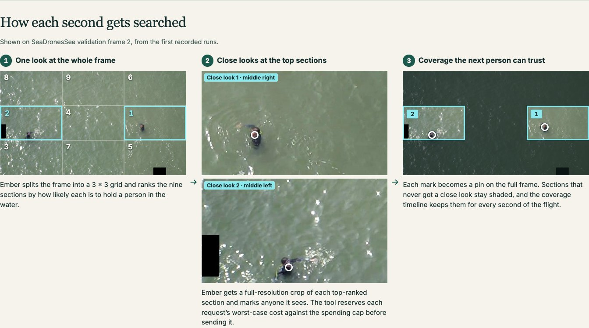

# How the project got here

Open Water Search started on November 23, 2026, the day Andrew was accepted into the Muse Ember Hackathon. The first idea was that Ember would search each frame alone: one look at the whole frame, then close looks at the water most likely to hold someone. It found swimmers, but a free trained detector found more with fewer false alarms ([ADR 0009](adr/0009-compare-against-a-trained-detector.md)). So the detector became the first pass and Ember's job became checking its flags ([ADR 0016](adr/0016-the-detector-makes-the-first-pass.md)). Every turn is in the [decision records](adr), and the words they use are in the [glossary](GLOSSARY.md). The November 23 experiment is in [experiments/zoom-first](../experiments/zoom-first).

## Why the unchecked water matters

On July 4, 2021, a Glendale, Wisconsin police drone found two paddleboarders on Lake Michigan and held a light on them while boats came in. The crew could reach the boats only through dispatch. Later, the officer told us: "Honestly, we didn't know if the boats knew." Finding someone is half the job. The other half is making sure the next person knows exactly where to look, and which water nobody has checked.

## How the original zoom experiment searched each second

1. **Overview.** Each frame gets one Ember call that ranks the nine sections of a 3 × 3 grid by how likely each is to hold a person in the water.
2. **Close looks.** Each frame then gets a close look at its top-ranked section, then its second, one round at a time, until the per-frame count (`--looks`, default 2) or the spending cap runs out. Before every request, the tool reserves the request's worst-case cost within `--budget`, including requests running concurrently. The current command also reserves for retries whose first attempt may have been billed.
3. **Search record.** Sightings in back-to-back seconds within 10% of the frame width merge into one possible person, and a gap of more than 2 seconds starts a new one. Code writes a handoff message for each possible person from the search record, and the coverage timeline keeps every section that never got a close look.

## Run record

- **Settings.** Model `muse-ember-1.0` on the Meta Model API, minimal reasoning, a 2,000-token output limit, 3 x 3 tiles resized to at most 1,000 pixels on the long edge, and JPEG quality 90. The prompts are in `probe/runner.py`, and their hashes are in each `settings.json`.
- **False start.** The first attempt used a 384-token output limit. Ember spent it on reasoning and returned empty answers for 14 of 16 overviews, which tripped the failure breaker after 46 calls ($0.0075). Earlier in that attempt, the reader was amended to accept a bare `[]` as an empty answer. The attempt is preserved, with response IDs removed, in `experiments/zoom-first/false-start/`. It was restarted from scratch with the 2,000-token limit, and its cost counted toward the $0.49 cap.
- **0–1,000 coordinates.** Some close looks returned points on Meta's 0–1,000 image grid instead of the fractions the prompt asked for. Before any label was opened, we fixed a rule that converts them. `score.json` applies it, and `score-strict.json` discards those answers.
- **Frames.** The first run's 30 frames were drawn by a seeded hash from a 400-image local training pool, listed in `experiments/zoom-first/training-30/inputs/training-pool.txt`. Validation drew 30 frames from the 1,547-image validation split, skipping any within 8 bits of a pool image on a 64-bit difference hash (`probe/select_validation.py`). Fifteen of the first 45 candidates were skipped, which suggests the splits share source videos. Nothing was tuned on any frame.
- **Spend.** $0.0662 for the first run plus $0.0075 for the false start, $0.0670 for validation, and $0.0023 for the four-frame tool test in `experiments/zoom-first/tool-test/`.
