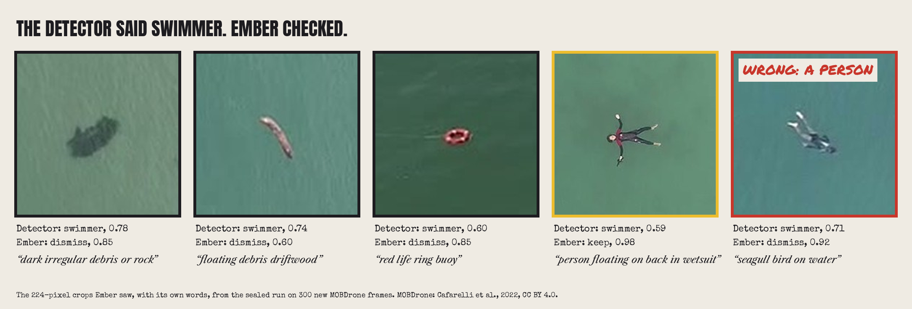

# Results

Every result here comes from a sealed run in [runs/](../runs). Each run's README gives its plan, its numbers and its cost, and its seal holds the SHA-256 of the Ember calls as written. The short version is in the [README](../README.md).

## The result: Ember checks the detector's flags

A free YOLO26m detector trained on SeaDronesSee finds most people in drone footage, but on water it hasn't seen it also flags rocks, driftwood, life rings and birds. In `--mode detector-check`, the detector scans every frame first, keeping every swimmer box at 0.05 confidence or more, at most 12 per frame. Ember then gets one request per flagged frame. Each flag arrives as a 224-pixel crop, and structured output makes Ember answer three questions for every crop: is a person in the water at its centre, how sure is it, and what is there.

~~~mermaid
flowchart LR
    flight["Flight: video or photos, one per second"] --> detector["Trained detector scans every frame whole, flags up to 12 spots"]
    detector --> ember["Muse Ember one request per flagged frame: person? how sure? what is it?"]
    ember -->|keep| record["Search record possible people with Ember's words, a handoff message for each"]
    ember -->|dismiss| reopen["Dismissed flags kept in the report for a person to reopen"]
~~~

**MOBDrone** (`runs/verify-mobdrone`). 300 MOBDrone frames, with 297 labeled people, chosen from video names and frame counts alone. Every frame is at least two seconds from any frame used before. The plan and pass rule were committed (82d5225) before any Ember call. The rule compares Ember's check with the detector alone at the highest confidence that still finds as many people.

| 297 labeled people in 300 new MOBDrone frames | Found | False alarms |
|---|---|---|
| Detector alone at 0.30, set to find as many | 210 | 166 |
| **Detector, then Ember** | **210** | **38** |
| Detector alone at 0.62, set to raise about as few false alarms | 125 | 36 |

Ember made 207 requests for $0.0318. A false alarm is any mark with no labeled person under it. Of Ember's 38, 20 are on empty water and 18 are second marks on a person already found.

**AFO** (`runs/verify-afo`). 300 photos from the test split of AFO, the Aerial dataset of Floating Objects (CC BY-NC-SA 3.0, used non-commercially), chosen from file names alone across all 17 of its source clips. Only its `human` boxes count as people, so a kept mark on a board, kayak, buoy or boat is a false alarm. The plan was committed (1a34171) before any Ember call. AFO frames are crowded: under five marks a photo, at most 874 of the 2,950 person appearances can be found by anyone.

| 2,950 person appearances in 300 AFO photos | Found | False alarms |
|---|---|---|
| **Detector, then Ember** | **619** | **85** |
| Detector alone at 0.05, its most sensitive | 611 | 445 |
| Detector alone at 0.25, as published | 556 | 310 |
| Detector alone at 0.60, set to raise about as few false alarms | 217 | 83 |

Ember made 255 requests for $0.0706. It dismissed 768 of the 850 flags that weren't on a person, mostly seaweed, rocks and people standing on land, and kept 991 of the 1,101 that were. The pass rule could not be applied as written, because no detector setting finds 619. Against the detector's most sensitive setting, Ember's check finds 8 more people with 81% fewer false alarms, a comparison chosen after the result.

**Where it did not help.** On 1,517 SeaDronesSee validation photos, the footage the detector was trained on, the same check lost. It found 3,904 people with 291 false alarms, while the detector's own threshold found 3,910 with 104 (`runs/verify-confirm`, $0.2690). So the detector does the first pass, and Ember's check earns its keep on water the detector doesn't know.

**What Ember gets wrong.** On MOBDrone both versions still miss 87 of the 297, and Ember dismissed 40 flags that were real people, calling them a dark shape, a bird or an animal. On AFO it dismissed 110, often describing the crop's centre as open water between two swimmers. That is why the report lists every dismissed flag with its crop and Ember's words.

**Live on a two-minute clip** (`runs/live-detector-check`, $0.0080). The command ran end to end on the same MOBDrone clip as Ember's own search below, in 57 seconds for two minutes of footage, and `terminal.jsonl` records every line it printed. It found 101 of 116 person appearances with no false alarms, and its sightings merged into 8 possible people for the clip's 4 labeled people, all real. On this clip the detector alone did better, finding 114 with 1 false alarm. Ember's check had almost nothing to remove and dismissed 13 real sightings, eight of them as a duck, a bird, a seal or a dolphin. Ember's own search on the clip left 15 possible people, 7 of them holding no one. A first take of the same command, from another folder, found 105 with 6 possible people (`runs/live-detector-check-first-take`).

**The one command reproduces the sealed run.** Running `--mode detector-check` on the same 300 frames, with the detector run fresh and Ember's sealed answers replayed, sent all 207 requests byte for byte as sealed and scored 210 found with 38 false alarms. `python runs/verify-mobdrone/replay_one_command.py OUT detector-venv/bin/python` repeats it with no network and no key.

## Ember's own search: a flight in, a search record out

Without `--mode detector-check`, Ember searches each frame alone: one overview ranks the nine sections of a 3 × 3 grid, then close looks go to the top-ranked ones. This was the project's first approach. It lost to the trained detector on both tests below, which is why the headline mode lets the detector go first. It needs no detector and no GPU, and it stays the default.

~~~mermaid
flowchart LR
    video["Flight as a video"] -->|"cut into one frame per second"| frames["One frame per second"]
    folder["Flight as a folder of photos, one per second, in time order"] --> frames
    frames --> fixed["Fixed method (default) one overview ranks the 9 sections, close looks at the top 2"]
    frames -.->|"--mode agent"| agent["Agent option Ember picks up to 4 close looks per frame through tool calls"]
    fixed --> sightings["Sightings"]
    agent -.-> sightings
    sightings -->|"back-to-back seconds, within 10% of the frame width"| people["Possible people"]
    people --> record["Search record possible people · coverage timeline · a handoff message for each"]
~~~

On November 24 the command searched a two-minute MOBDrone clip live, one frame per second:

~~~
python3 probe/open_water_search.py clip.mp4 --out runs/live-clip --budget 0.10
~~~

It printed each overview and close look as its answer arrived, then a handoff message for each possible person. Every line, with its time, is in `runs/live-clip/terminal.jsonl`:

~~~
second-00009: close look at the middle right: 1 possible person, confidence 0.95
...
Possible person 1. First seen 0:06, last seen 0:36 into the flight, in the middle left section of second-00036. Confidence 0.98. 7 of the 9 sections of that frame were never searched.
~~~

| The live clip | Result |
|---|---|
| Seconds of footage | 120 |
| Person appearances found | 107 of 116 (92%) |
| Marks with no person | 47 |
| Possible people | 15, for 4 labeled people |
| Cost | $0.0531 |
| Photos per minute | 46.9 (wall time 153.6 s, including cutting the video) |

`probe/check_merge_rule.py` checked how sightings merged into possible people against MOBDrone's track IDs:

- It never joined two different people.
- All 4 labeled people were split into more than one possible person: 6 splits, all within two seconds.
- 7 of the 15 possible people hold no labeled person. MOBDrone labels only people, so some may be boats or buoys, and the rest are false sightings.

The clip carried no drone position, so its handoff messages give the time and the section of the frame. They give no map coordinates.

Every section of every second ends the search in one of four states on the coverage timeline:

~~~mermaid
stateDiagram-v2
    state "Not checked (shaded)" as unchecked
    state "Flagged: Ember marked someone" as flagged
    state "Checked, no sighting" as clear
    state "Unreadable: the answer couldn't be read" as unreadable
    [*] --> unchecked: the overview ranks the section
    unchecked --> flagged: close look with a mark
    unchecked --> clear: close look, nothing marked
    unchecked --> unreadable: close look, unreadable answer
~~~

A section checked with no sighting means Ember looked and reported no one. It does not mean the water is empty.

## The scale run: all 1,547 SeaDronesSee validation photos

Every photo in the SeaDronesSee validation split ran as one flight through the default fixed method on November 24: one overview and two close looks per photo, grounding format, up to 8 requests at once, spending cap $1.47. The trained detector ran on the same photos for comparison (`runs/scale-run`, `detector/`).

| 6,206 swimmers in 1,547 photos | Found | Missed | Marks with no swimmer | Cost | Time |
|---|---|---|---|---|---|
| Ember, fixed method | 3,876 (62%) | 2,330 | 874 | $0.9571 | 44 min |
| Trained detector, whole photo at 640 | 4,283 (69%) | 1,923 | 144 | $0 (local) | about 2 min |
| Trained detector, 3×3 tiles at 640 | 4,213 (68%) | 1,993 | 408 | $0 (local) | about 12 min |

- **Cost:** $0.9571 for 4,641 calls, or about $0.00062 per photo. At one photo a second that is about $2.23 per hour of footage.
- **Speed:** 35.1 photos a minute over the whole run (2,646 s), short of the 60 a minute needed to keep pace with one photo a second. The live clip reached 46.9.
- **Reliability:** every overview was read, with no lost requests and no unreadable answers. The first attempt ended after 57 calls when one request timed out. The fix (one retry, then only that request is lost) is in commit e68172f, and that attempt's $0.0208 is counted in the project's spending.

## Ember alone loses to the trained detector

A YOLO26m detector trained on SeaDronesSee (`detector/`, AGPL-3.0) found more people with fewer false marks than Ember on both tests, under the same scoring rule. On SeaDronesSee its checkpoint was chosen on the same validation split it was scored on, so its numbers there lean optimistic. MOBDrone is footage neither had seen, and the detector won there too:

| 311 labeled people in 300 MOBDrone frames | Found | Missed | Marks with no person | Cost |
|---|---|---|---|---|
| Trained detector, whole photo at 640 | 228 | 83 | 194 | $0 (local) |
| Trained detector, 3×3 tiles at 640 | 217 | 94 | 400 | $0 (local) |
| Ember, fixed method | 205 | 106 | 232 | $0.1364 |

The 300 frames were spread across all 66 MOBDrone videos with a fixed seed and listed before any frame or label was viewed (`mobdrone/frames.json`). A mark counts when it lands inside a labeled box, each box counts once, and each photo keeps at most five marks. The detector's settings were fixed before any label was seen, and `detector/README.md` has both of its runs on every set.

What Ember offers instead:

- **No training data.** Ember was never trained on drone photos and found 205 of the 311 people (66%) on footage new to it. Nothing has to be labeled or trained before a new camera or stretch of water can be searched.
- **A search record and handoff a crew can act on.** A flight comes back as possible people with the seconds they were seen, a coverage timeline of the water nobody searched, and a handoff message for each possible person.
- **A measured, capped cost.** About $0.00062 per photo, or about $2.23 per hour of footage at one photo a second, with the default grounding format. The detector runs free on a local GPU. The tool stops before any request could cross its spending cap.

## Two checks on the 30 validation photos

**Meta's grounding format became the default** (`runs/format-check`). Close looks asked for points on Meta's 0–1,000 grid, with structured output forcing a JSON schema. The pass rule was fixed in advance:

| 134 swimmers | Pass rule | Result |
|---|---|---|
| Found with one close look | at least 63 | 69 |
| Found with two close looks | at least 74 | 79 |
| Marks with no swimmer, two close looks | at most 24 | 13 |

**Letting Ember choose its own close looks lost** (`runs/agent-check`). With `--mode agent`, Ember saw each overview and chose its close looks through three tools: look closer at a tile, report a sighting, and move to the next frame. It had to beat the fixed method at the same total spend:

| 134 swimmers, equal spend | Found | Marks with no swimmer | Calls |
|---|---|---|---|
| Fixed method, grounding format | 79 | 13 | 90 |
| Agent mode | 54 | 11 | 51 |

Each tool-calling step resends the frame's conversation and the tool definitions, so the same money bought 51 calls instead of 90, and 9 of the 30 photos never got a close look. The fixed method stays the default, and agent mode stays available.

## Supporting detail: where the first close look goes

Before the scale run, we compared three ways to spend close looks on the same 30 photos, using the same recorded Ember answer for every crop, so only the order in which tiles are opened differs. These runs used the original frozen prompts.

- **Ember picks the tile** from its one overview.
- **Always zoom the center** first, then continue in grid order.
- **Fixed grid order.**

~~~mermaid
xychart-beta
    title "One close look per photo: swimmers found of 134"
    x-axis ["Ember picks the tile", "Always zoom the center", "Fixed grid order"]
    y-axis "Swimmers found" 0 --> 134
    bar [63, 30, 7]
~~~

**Validation: 30 untouched SeaDronesSee validation frames, 134 swimmers.** The measure and the pass rule were written down before any call. Each cell counts labeled swimmers found under a limit of five sightings per frame. Ranges cover the two answer sets, one from each search's pass over the frames.

| Close looks per frame | 1 | 2 | 3 | All 9 |
|---|---|---|---|---|
| Ember picks the tile from one overview | 63–64 | 74 | 75–77 | 77–78 |
| Always zoom the center first | 30–31 | 31–33 | 34–37 | 76–78 |
| Fixed grid order | 7 | 16 | 24–25 | 77–78 |

With all nine tiles opened, every order finds the same swimmers. The gain comes from where the first looks go.

**First run: 30 SeaDronesSee training frames, 158 swimmers.** This comparison was defined after the labels were opened, which is why we repeated it on validation.

| Close looks per frame | 1 | 2 | 3 | All 9 |
|---|---|---|---|---|
| Ember picks the tile from one overview | 65–73 | 83–92 | 86–95 | 85–94 |
| Always zoom the center first | 28–38 | 30–41 | 42–53 | 85–94 |
| Fixed grid order | 7–10 | 18–24 | 36–44 | 85–94 |

From one overview, Ember's first-ranked tile held a labeled swimmer in 26 of 30 first-run frames and 24 of 30 validation frames. With the frozen prompts, an overview plus two close looks cost about $0.00052 per photo, or $1.88 per 3,600 photos. The current grounding-format default measured about $0.00062 per photo on the scale run, about $2.23 per hour of footage.

## What this does not show

- **Detector, then Ember on other footage.** It has been tested on two datasets the detector never saw, MOBDrone and AFO. On SeaDronesSee, the detector's own footage, Ember's check lost to the detector's threshold. Other footage is untested.
- **Keeping pace with a drone.** The search reached 35.1 photos a minute on the scale run and 46.9 on the live clip, short of one photo a second.
- **Equal spend with each search's own answers.** In the frozen-prompt runs we planned this head-to-head too, and it does not support a claim either way. In the first run, both searches eventually sent identical crops, and Ember returned a different number of marks on 12 of those 270 crops between passes. That variation is as large as the gap between the searches. In validation, the totals were 78 against 77 with our reader and 75 against 65 with a stricter one. Both scorecards are published.
- **Reviewer speed.** There is no claim that a reviewer finds people faster. That needs a timed test on fresh footage.

## Muse Ember usage

The November 23 runs used the frozen prompts. Their token usage, from the answers Meta returned:

| | Calls | Input tokens | Cached input | Output tokens | Reasoning tokens | Cost |
|---|---|---|---|---|---|---|
| First run | 570 | 396,696 | 61,786 | 64,829 | 52,879 | $0.0662 |
| False start | 46 | 33,333 | 0 | 8,345 | 7,718 | $0.0075 |
| Validation | 570 | 373,864 | 61,606 | 70,966 | 59,924 | $0.0670 |
| Tool test | 12 | 7,632 | 0 | 3,116 | 2,712 | $0.0023 |
| **Total, November 23** | **1,198** | **811,525** | **123,392** | **147,256** | **123,233** | **$0.1429** |

Costs use Meta's published Muse Ember rates: $0.10 per million input tokens, $0.004 per million cached input tokens and $0.50 per million output tokens, below 200,000 tokens of context. Each call's prompt hash, image hash, timing, usage and raw answer are in the traces.

The November 24 runs, with the cost each run folder's README reports. Every call's token usage and cost are in that folder's `calls-redacted.jsonl`.

| Run | Cost |
|---|---|
| Format check, 90 calls (`runs/format-check`) | $0.0192 |
| Agent check, 51 calls (`runs/agent-check`) | $0.0178 |
| Scale run, first attempt, stopped by a timeout after 57 calls | $0.0208 |
| Scale run, 4,641 calls (`runs/scale-run`) | $0.9571 |
| MOBDrone, 300 frames (`runs/mobdrone-300`) | $0.1364 |
| Live two-minute clip (`runs/live-clip`) | $0.0531 |
| Detector, then Ember: 300 MOBDrone frames and 30 validation photos (`runs/verify-check`) | $0.0391 |
| Detector, then Ember: confirmation on 1,517 validation photos, failed (`runs/verify-confirm`) | $0.2690 |
| Detector, then Ember: 300 new MOBDrone frames, passed (`runs/verify-mobdrone`) | $0.0318 |
| Detector, then Ember: live two-minute clip, one command, first take (`runs/live-detector-check-first-take`) | $0.0081 |
| Detector, then Ember: live two-minute clip, re-run from the repository folder (`runs/live-detector-check`) | $0.0080 |
| Detector, then Ember: 300 AFO photos (`runs/verify-afo`) | $0.0706 |
